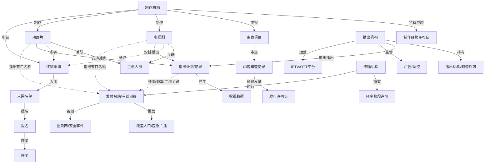

# 广电数据图谱扩展挖掘（可编辑）

> 参考格式：GD 项目数据图谱 V4 的"核心实体定义"口径（关联主体 / 数据来源 / 核心属性），但不局限于 V4
> 挖掘依据：《广播电视和网络视听统计调查制度》（广基 1–22 表）、广电各类机构管理规章、行政许可与监管口径
> 数据标注：【V4 已有】【可挖掘·统计】【可挖掘·许可监管】【外部待对接】
> 版本：V1.1　日期：2026-11-02（内容明确为电视剧和动画片，新增评审评奖全流程信息）

---

## 目录

1. [挖掘思路与数据全景](#1-挖掘思路与数据全景)
2. [制作机构及其关联数据](#2-制作机构及其关联数据)
3. [播出机构及其关联数据](#3-播出机构及其关联数据)
4. [传输（传播）机构及其关联数据](#4-传输传播机构及其关联数据)
5. [跨机构公共与支撑数据](#5-跨机构公共与支撑数据)
6. [扩展实体关系总览](#6-扩展实体关系总览)
7. [数据来源系统与对接建议](#7-数据来源系统与对接建议)

---

## 1. 挖掘思路与数据全景

V4 仅覆盖"机构基本信息 + 7 类许可证"。结合广电统计调查制度和机构管理规章，可沿三条机构主线向下挖掘：**资质许可、备案审查、业务运行（统计）、人员、财务经营、安全与信用**，并以统一社会信用代码为主键贯通。

| 机构主线 | V4 已有 | 可挖掘的主要扩展方向 |
|---|---|---|
| 制作机构 | 基本信息、电视剧/动画片发行许可证 | 制作经营资质、拍摄备案、审查修改、电视剧/动画片制作统计、主创人员、投资、评审评奖（申请/入围/提名/获奖）、处罚信用 |
| 播出机构 | 基本信息、视频点播/信息网络传播许可证 | 播出机构及频道许可、节目播出统计、编排记录、广告、收视大数据、调控、IPTV/OTT |
| 传输（传播）机构 | 基本信息、频段频率许可证、入网证书 | 有线/无线/卫星传输统计、发射台站、覆盖人口、应急广播、监测网、安全播出 |

---

## 2. 制作机构及其关联数据

### 2.1 制作机构主体【V4 已有】

- 关联主体：机构本身，作为各类资质、电视剧/动画片、备案、处罚的挂载中心
- 数据来源：统一用户系统（目前仅制作机构有系统来源）
- 核心属性：机构名称、统一社会信用代码、机构类型、企业地址、电话、法定代表人、联系人、注册资本、经营范围、许可类别

### 2.2 广播电视节目制作经营许可证【可挖掘·许可监管】

- 关联主体：制作机构（机构资质，区别于作品发行许可证）
- 数据来源：广播电视节目制作经营单位审批/政务服务系统
- 核心属性：许可证编号、持证机构、发证机关、发证日期、有效期（2 年）、年检/年报状态、许可范围、变更记录、注销/吊销状态
- 依据：《广播电视节目制作经营管理规定》（广电总局令，2025 年修正）

### 2.3 拍摄制作备案与拍摄许可【可挖掘·许可监管】

- 关联主体：制作机构、电视剧/动画片
- 数据来源：电视剧（网络剧）管理信息系统、动画片管理系统
- 核心属性：备案号、剧目/片名、备案类型（一般题材/重大革命历史题材）、申报机构、备案日期、公示批次、备案状态、申报集数、拍摄许可证号（乙种/单剧）

### 2.4 内容审查记录与修改通知单【可挖掘·许可监管】

- 关联主体：电视剧/动画片、审查专家、制作机构
- 核心属性：审查批次号、审查类型、审核结论（通过/修改后通过/不通过）、审查意见、审查日期、主审/参审专家、依据法规、修改要点、复核结果

### 2.5 电视剧/动画片制作运行数据【可挖掘·统计】

- 关联主体：制作机构、电视剧/动画片
- 数据来源：广基 4 表"节目制作情况统计年报"
- 核心属性：制作数量，按电视剧、动画片分类的制作数量与时长、自制/合作制作、制作完成时间、发行情况

### 2.6 电视剧、动画片与主创人员【V4 部分已有 + 可挖掘】

- 关联主体：制作机构、电视剧/动画片、从业人员
- 核心属性：
  - 电视剧：剧名、集数、题材分类（一级/二级）、导演、编剧、拍摄日期、制作周期、制作预算、原创情况、剧本及万字大纲、联合制作机构、主要演员、制片人、监制、完成时间、剧情梗概、内容标签、发行许可证号
  - 动画片：片名、集数、题材、形式、拍摄时间、制作方式、内容提要、故事梗概、剧本创意来源、动画形象创意来源、发行许可证号
  - 主创：导演、编剧、主演、制片人、监制、摄影等人员 ID、角色、职务、身份证号、职称、代表作品

### 2.7 评审评奖信息【可挖掘·许可监管】

- 关联主体：电视剧/动画片、制作机构、评审专家，覆盖评奖全流程四个阶段
- 数据来源：评奖申报与评审系统（飞天奖、五个一工程、金鹰奖等）
- 分阶段核心属性：

| 阶段 | 关系 | 核心数据要素 |
|---|---|---|
| 申请（申报） | `申报参评` | 申报编号、奖项名称、届次、申报作品、申报机构、申报日期、申报材料、受理状态 |
| 入围 | `入围` | 入围名单、入围编号、入围作品、公布日期、评审初评意见 |
| 提名 | `获得提名` | 提名编号、提名作品、提名奖项类别、提名公布日期、提名评审意见 |
| 获奖 | `获奖` | 获奖等级（一等/二等/优秀等）、获奖证书编号、颁奖日期、颁奖单位、获奖作品与主创 |

### 2.8 行政处罚与信用【可挖掘·许可监管】

- 关联主体：制作机构、电视剧/动画片
- 核心属性：行政处罚决定书文号、违法类型、违法事实、处罚内容、处罚日期、处罚机关、信用异常/严重违法失信名单状态、许可证吊销记录

---

## 3. 播出机构及其关联数据

### 3.1 播出机构主体【V4 已有】

- 数据来源：机构实体（播出机构暂无独立系统来源）
- 核心属性：机构名称、统一社会信用代码、所属电视台、频道、覆盖区域、传输方式、许可证编号

### 3.2 播出机构许可证与频道资源【可挖掘·许可监管】

- 关联主体：播出机构、频道
- 数据来源：传媒机构管理/政务服务系统
- 核心属性：播出机构许可证号、频道呼号/标识、频道类型（卫视/综合/专业）、公共/付费频道、套数、传输方式（卫星/有线/地面/IPTV/网络）、覆盖区域、上星时间、许可有效期

### 3.3 节目播出运行数据【可挖掘·统计】

- 关联主体：播出机构、频道、电视剧/动画片
- 数据来源：广基 1 表"广播播出情况"、广基 2 表"电视播出情况"
- 核心属性：节目播出语种、节目套数、公共/付费节目播出时间、按节目类型（新闻/综艺/广告/少儿/对农等）播出时长、自制/购买交换节目时间、手语/字幕栏目、电视剧/动画片播出数、被总台采用条数

### 3.4 播出编排、记录与收视数据【可挖掘·统计】

- 关联主体：播出机构、电视剧/动画片、频道
- 核心属性：播出计划/排期、播出时段、播出方式（独播/联播/重播）、实际播出记录、播出剧集序号、收视率（CVB 中国视听大数据口径）、市场份额、同时段排名

### 3.5 广告播出与播出调控【可挖掘·许可监管】

- 关联主体：播出机构、广告主
- 核心属性：广告播出记录、广告时长/时段、广告合规状态、播出调控指令（限播/停播/调档/题材比例）、覆盖范围、生效与截止日期、指令依据

### 3.6 IPTV、OTT 与融合媒体【可挖掘·统计 + 许可监管】

- 关联主体：播出机构、集成播控平台、网络视听机构
- 数据来源：广基 14 表"互联网电视（OTT）"、广基 15 表"IPTV"、融合媒体备案
- 核心属性：平台名称、运营机构、集成平台/内容服务平台、用户规模、覆盖省份、终端类型、上线内容、备案号与状态

---

## 4. 传输（传播）机构及其关联数据

### 4.1 传输机构主体与频率许可【V4 已有】

- 数据来源：机构实体、全国广播电视传输覆盖管理电子政务系统
- 核心属性：传输机构名称、统一社会信用代码、频段频率许可证号、发射台、频率、功率、天线参数、播出节目名称、发证/截止时间

### 4.2 无线传输覆盖与发射台站【可挖掘·统计】

- 关联主体：传输机构、发射台/转播台/微波站
- 数据来源：广基 8 表"广播电视转播发射传输情况"、《广播电视无线传输覆盖网管理办法》
- 核心属性：中短波/调频/电视转播发射台数量及等级、发射机数量与功率、数字/模拟发射设备、微波站与微波线路、频率指配证明、无线电台执照

### 4.3 有线电视网络运行数据【可挖掘·统计】

- 关联主体：有线电视网络机构、用户
- 数据来源：广基 7 表"有线广播电视情况"
- 核心属性：传输干线长度、覆盖/实际用户数、减免用户、FTTH 光纤到户用户、视频点播用户、互联网宽带及增值业务用户、智能终端用户

### 4.4 卫星传输数据【可挖掘·统计】

- 数据来源：广基 8 表卫星传输部分
- 核心属性：卫星地球站数量、卫星上行系统/载波数量、上行节目套数、卫星监测数据（依据 GY/T 378—2023）

### 4.5 覆盖人口与应急广播【可挖掘·统计】

- 关联主体：传输机构、县级主管部门、应急广播运营单位
- 数据来源：广基 10 表"覆盖情况"、广基 9 表"应急广播情况"
- 核心属性：广播/电视综合覆盖人口、综合覆盖率、覆盖方式（无线/有线/卫星）、应急广播平台/终端数量、播发次数、联动记录

### 4.6 监测网、设备入网与安全播出【V4 部分 + 可挖掘】

- 关联主体：传输机构、监测台、安全播出责任单位
- 核心属性：监测台（中心）数量、监测/码流/频谱数据、设备器材入网认定证书（V4 已有，仅基础绑定）、安全播出事件、事故级别、处置状态、根因分析

---

## 5. 跨机构公共与支撑数据

| 数据类别 | 数据来源（报表/系统） | 核心数据要素 | 关联对象 |
|---|---|---|---|
| 从业人员 | 广基 17 表 | 人员数量、岗位结构、学历、职业资格（播音员主持人/编辑记者） | 三类机构 |
| 财务状况 | 广基 18 表 | 资产、收入、财政补助、支出 | 三类机构 |
| 经营情况 | 广基 19 表 | 创收、业务收入构成、经营状态 | 三类机构 |
| 产业基地（园区） | 广基 16 表 | 园区名称、入驻机构、产值、运营情况 | 制作/播出机构 |
| 网络视听 | 广基 11/12/13 表 | 互联网视频/音频、短视频、UV、上线内容 | 网络视听机构 |
| 进出口与出海 | 广基 5/6 表 | 节目进口、出口、落地国家地区、合拍、出海收入 | 制作/播出机构 |
| 法规标准 | 政策法规/标准化系统 | 法规文件、行业/技术标准、政策文号、效力状态 | 全部实体 |
| 外部监管数据 | 【外部待对接】市监、网信、文旅、公安 | 经营情况、监管处罚、信用、网络安全 | 三类机构 |

---

## 6. 扩展实体关系总览

### 6.1 关键关联关系（可编辑）

| 编号 | 源实体 | 关系 | 目标实体 | 关联字段 | 数据状态 |
|---|---|---|---|---|---|
| P1 | 制作机构 | 持有资质 | 制作经营许可证 | 统一社会信用代码 | 可挖掘 |
| P2 | 制作机构 | 申报/审查 | 备案项目、审查记录 | 机构代码、备案号 | 可挖掘 |
| P3 | 制作机构 | 制作 | 电视剧、动画片 | 作品 ID、机构代码 | 可挖掘 |
| A1 | 电视剧/动画片 | 申报参评→入围→提名→获奖 | 评奖申请/入围/提名/获奖 | 申报编号、奖项届次 | 可挖掘 |
| B1 | 播出机构 | 持有/运营 | 频道许可、播出记录 | 频道呼号、许可证号 | 可挖掘 |
| B2 | 电视剧/动画片 | 安排播出 | 播出计划 | 剧目/片名 | 可挖掘 |
| T1 | 传输机构 | 运行 | 台站/有线网络 | 频率、台站 ID | 可挖掘 |
| T2 | 播出/传输 | 二次关联 | 台站/网络 | 频道/频率、播出节目名称 | 部分缺口 |
| C1 | 三类机构 | 关联 | 人员/财务/经营 | 机构代码 | 可挖掘 |

---

## 7. 数据来源系统与对接建议

### 7.1 数据来源分级

| 状态 | 含义 | 数据举例 |
|---|---|---|
| 【V4 已有】 | 现有图谱已覆盖 | 机构基本信息、7 类许可证 |
| 【可挖掘·统计】 | 统计制度已采集，可对接统计/年报系统 | 广基 1–22 表对应的运行、覆盖、人员、财务数据 |
| 【可挖掘·许可监管】 | 审批/监管业务系统中存在 | 制作经营许可、播出/频道许可、备案审查、评审评奖、调控、处罚 |
| 【外部待对接】 | 需跨部门共享 | 市场监管、网信、文旅、公安数据 |

### 7.2 对接建议

1. 优先打通统计调查/年报系统，复用广基系列报表，快速补全三类机构的运行与覆盖数据。
2. 对接政务服务与许可审批系统，补齐制作经营、播出频道等资质与备案审查数据。
3. 所有扩展实体沿用统一社会信用代码主键、机构名称辅键，与 V4 一次/二次关联规则保持一致。
4. 外部数据先以目录和接口方式登记，明确口径后再挂载，避免一数多源。
5. 关联缺口（如播出频道与播出/传输机构系统关联）在数据标准化阶段单列校验，不做臆测补全。

---

> 编辑提示：新增实体请按"关联主体 / 数据来源 / 核心属性"格式在对应机构章节追加，并同步更新第 6 章关系图与第 7 章来源分级，保持图、表、来源口径一致。
